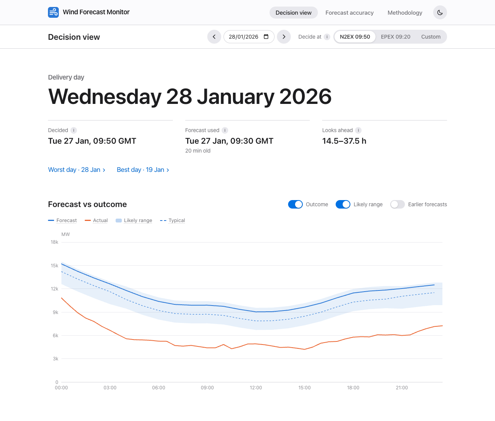
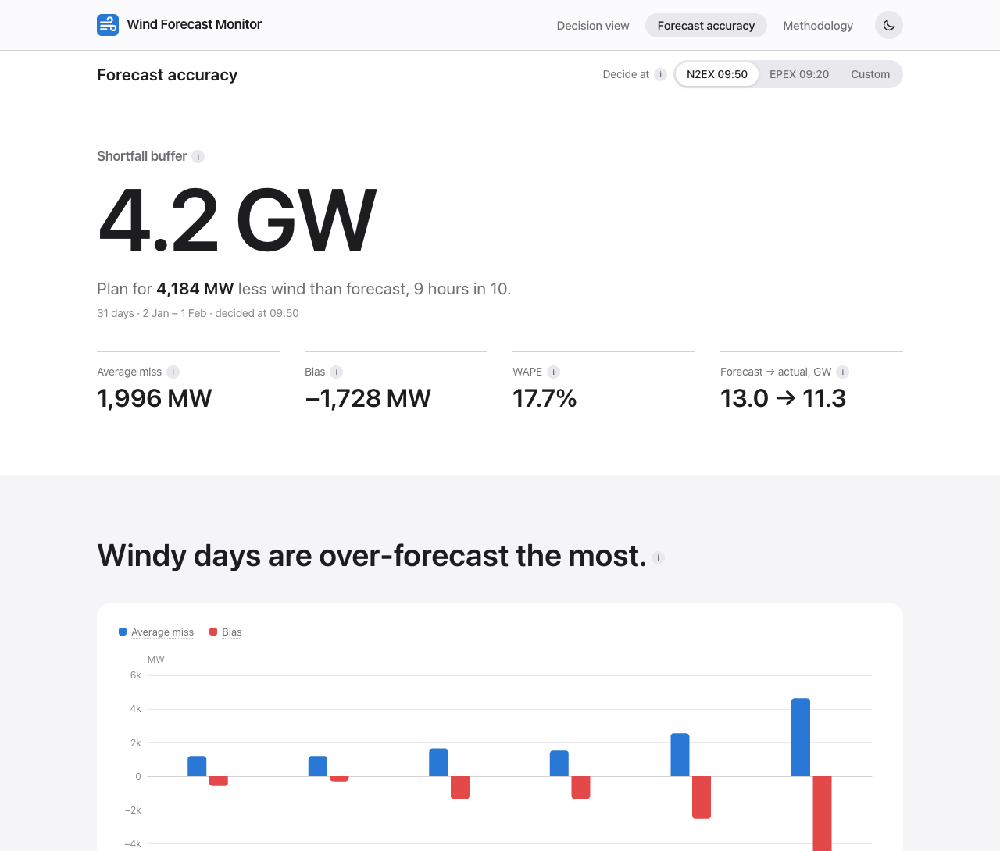
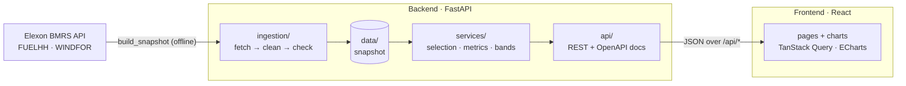

# wr4c0m: Wind Forecast Monitor

[](https://github.com/prakhar23381/wr4c0m/actions/workflows/ci.yml)

A web app for a UK utility's day-ahead purchasing team. For any delivery day it shows **the national wind forecast that was available when the purchase had to be made**, how far that forecast can be trusted, and how accurate such forecasts were across January 2026.

- **Live app:** https://wr4c0m.vercel.app
- **API docs (interactive):** https://wr4c0m.vercel.app/api/docs

| Decision view | Forecast accuracy |
|---|---|
|  |  |

## What it shows

- **Decision view:** pick a delivery day and a decision time (the N2EX 09:50 or EPEX 09:20 gate closure, or any time). The app shows which forecast was the latest one published by then, how old it was, and how far ahead it looked. It then draws that forecast with a likely range and, in hindsight, the actual wind. Includes an hourly table and a CSV download.
- **Forecast accuracy:** error metrics for the decision-time forecast across all 31 delivery days. Breakdowns by wind level, day, hour and lead time, plus what a later decision time would have changed.
- **Methodology:** data, rules, metric definitions and limitations on one page.

**Key findings (decisions at 09:50, January 2026):**
- Forecasts ran **1.7 GW too high** on average: mean forecast 13.0 GW, actual 11.3 GW.
- Planning for **4.2 GW less wind than forecast** covers the shortfall in 9 hours out of 10.
- The over-forecast grows with the wind level: about −4.6 GW when 20 GW or more is forecast. Curtailment is a likely cause, but the data in scope can't confirm it.
- The more accurate 11:30 forecast arrives after both auction gates have closed, so the buffer is what protects the purchase.

## How to start the application

### With Docker (recommended)

Requires Docker with Compose.

```bash
git clone https://github.com/prakhar23381/wr4c0m.git
cd wr4c0m
docker compose up --build
```

Open http://localhost:8080. Interactive API docs are at http://localhost:8080/api/docs. Stop with `Ctrl+C`, then `docker compose down`.

### Without Docker

Requires Python 3.12+ and Node.js 22.12+.

```bash
# Backend: http://localhost:8000
cd backend
python3 -m venv .venv
.venv/bin/pip install -e ".[dev]"
.venv/bin/uvicorn app.main:app --port 8000

# Frontend, in a second terminal: http://localhost:5173 (proxies /api to :8000)
cd frontend
npm ci
npm run dev
```

No API keys or environment variables are needed. The app reads a data snapshot committed in `backend/data/`.

### Tests and checks

```bash
cd backend && .venv/bin/pytest && .venv/bin/ruff check . && .venv/bin/mypy app   # 54 tests
cd frontend && npm test && npm run typecheck && npm run lint                    # 13 tests
```

CI runs all of these on every push, then builds both Docker images and smoke-tests the app through nginx (`.github/workflows/ci.yml`).

### Refreshing the data

```bash
cd backend && .venv/bin/python -m app.ingestion.build_snapshot
```

This downloads FUELHH and WINDFOR for the in-scope window from the Elexon BMRS API, cleans and checks them, and rewrites `backend/data/`. The CSV files come out byte-identical if the source data is unchanged.

## Files and directories

```
.
├── README.md                      This file
├── docker-compose.yml             Runs backend + frontend locally on :8080
├── vercel.json                    Vercel Services config: static frontend + Python backend, /api routing
├── .vercelignore                  Files kept out of Vercel uploads (tests, caches, notebooks)
├── .gitignore
├── .github/workflows/ci.yml       CI: backend checks, frontend checks, Docker build + smoke test
├── docs/                          Screenshots used in this README
├── notebooks/
│   └── analysis.ipynb             Exploratory analysis of January 2026 forecast errors (executed, with figures)
├── backend/                       Python 3.12 + FastAPI
│   ├── Dockerfile                 python:3.12-slim, non-root user, health check, uvicorn on :8000
│   ├── .dockerignore
│   ├── pyproject.toml             Pinned dependencies (also used by Vercel), ruff / mypy / pytest config
│   ├── data/
│   │   ├── actuals.csv.gz         FUELHH wind outturn, half-hourly (1,488 rows)
│   │   ├── forecasts.csv.gz       WINDFOR forecasts, hourly, every publish in scope (14,287 rows, 256 publishes)
│   │   └── metadata.json          Snapshot provenance and data-quality report
│   ├── app/
│   │   ├── main.py                App factory: routers under /api, CORS, cache headers, docs at /api/docs
│   │   ├── config.py              Settings (default cutoff, timezone, scope dates), overridable via APP_* env vars
│   │   ├── api/
│   │   │   ├── decision.py        GET /api/decision, /api/vintages: forecast at the cutoff, likely range, actuals
│   │   │   ├── accuracy.py        GET /api/accuracy/{summary,breakdown,distribution,cutoffs}
│   │   │   ├── meta.py            GET /api/meta: scope, cutoff presets, snapshot info
│   │   │   ├── health.py          GET /api/health
│   │   │   ├── params.py          Shared query parameters and validation (422 on out-of-scope input)
│   │   │   └── schemas.py         Pydantic response models
│   │   ├── services/
│   │   │   ├── selection.py       Which forecast was available at a given cutoff (no look-ahead)
│   │   │   ├── metrics.py         Alignment of forecast to actuals; MAE, RMSE, bias, WAPE, percentiles, breakdowns
│   │   │   ├── bands.py           Likely range: forecast + historical error quantiles at a similar wind level
│   │   │   └── analysis.py        Cached decision-time and all-publish error tables used by the API
│   │   ├── repository/
│   │   │   └── snapshot.py        Read/write the committed snapshot
│   │   └── ingestion/
│   │       ├── elexon_client.py   Elexon BMRS API client (chunked requests, retries with backoff)
│   │       ├── clean.py           Raw records → tidy UTC tables, deduplicated
│   │       ├── quality.py         Data-quality checks (gaps, late publishes, implausible values)
│   │       └── build_snapshot.py  CLI: fetch → clean → check → write backend/data/
│   └── tests/                     pytest: API (against the real snapshot), selection, metrics, bands,
│                                  cleaning, quality, Elexon client (mocked HTTP), snapshot round trip
└── frontend/                      React 19 + TypeScript + Vite
    ├── Dockerfile                 Node build stage → unprivileged nginx on :8080
    ├── nginx.conf                 Serves the app, proxies /api to the backend (same routing as Vercel)
    ├── .dockerignore, .gitignore, .oxlintrc.json
    ├── index.html                 Page shell; applies the light/dark theme before first paint
    ├── package.json, package-lock.json
    ├── vite.config.ts             Dev proxy to :8000, chart bundle split, Vitest config
    ├── tsconfig*.json             TypeScript config
    ├── public/favicon.svg
    └── src/
        ├── main.tsx               Router (lazy-loaded pages) and data-fetching client
        ├── index.css              Design tokens (light and dark), type scale, Tailwind theme
        ├── api/                   types.ts (mirrors the API schemas), client.ts (fetch + errors), hooks.ts (TanStack Query)
        ├── components/            Layout.tsx (header, theme toggle), CutoffPicker.tsx, EChart.tsx (chart wrapper),
        │                          ui.tsx (chapters, tiles, tooltips, switches, segmented control…)
        ├── pages/                 DecisionPage, AccuracyPage, MethodologyPage, NotFoundPage;
        │   ├── decision/          decisionChart.ts: chart builder for the decision view
        │   └── accuracy/          charts.ts: chart builders for the accuracy page
        ├── lib/                   UK-time and number formatting, CSV export, chart theme, light/dark theme,
        │                          URL-state hooks (date and cutoff live in the URL, so views are shareable)
        └── test/                  Vitest setup and fixtures (tests sit next to the code as *.test.ts[x])
```

## How it works

**Data and scope.** Only Elexon BMRS **FUELHH** (fuel type WIND, half-hourly metered output) and **WINDFOR** (hourly forecasts, published about 8 times a day) are used, for purchase decisions made in January 2026. Each decision on day D−1 buys for day D, so the delivery days are 2 January to 1 February 2026. The data is downloaded once into a versioned snapshot and checked for gaps, duplicates, late publishes and implausible values.

**Decision time.** For each delivery day the app uses the **latest forecast published at or before the decision time on D−1**, so nothing published later can leak in. The default is the N2EX day-ahead gate closure at 09:50 UK time. EPEX (≈09:20) and any custom time can be selected. All times are shown in UK time.

**Metrics.** Error = actual − forecast, so negative means less wind than forecast. The app reports MAE, RMSE, bias (mean error), WAPE (MAPE is avoided because it blows up in calm hours) and the P10/P50/P90 of hourly errors. The **shortfall buffer** is −P10: it covers the shortfall in 9 hours out of 10. Each hourly forecast is compared with the actual half-hour starting on the hour. Averaging both half-hours instead changes MAE by under 1%.

**Likely range.** Forecast errors grow with the wind level, so the band on the decision view is the forecast plus the P10/P50/P90 of past errors for forecasts at a similar level (4 GW buckets). It is computed **leaving out the day on screen**, so it isn't fitted to the outcome it's shown against. It still comes from the same month, so treat it as illustrative.

**Architecture.**



- A FastAPI backend computes everything from the snapshot. Results are cached in memory and at the CDN, since the data only changes on deploy.
- A React single-page app renders it with ECharts.
- On Vercel, the frontend is served as static files and the backend runs as a Python function behind `/api`.
- Locally, Docker Compose runs the same split with nginx in front.

**Limitations.**
- One winter month is a small sample.
- The curtailment explanation is a hypothesis.
- Embedded (distribution-connected) wind isn't in FUELHH.
- There is no price or demand data, so errors are in MW and MWh, not £.

## Use of AI tools

This project was built with the help of AI tools. **Claude Code** (Anthropic's AI coding assistant) was used throughout:
- planning
- probing the Elexon API
- writing the backend, frontend, tests, Docker and CI configuration
- data analysis
- UI design iterations
- this README

All code was run and checked: unit and API tests, type checking and linting in CI, Docker builds, and scripted browser checks of the deployed app. Numbers shown in the app were cross-checked against the analysis notebook.
